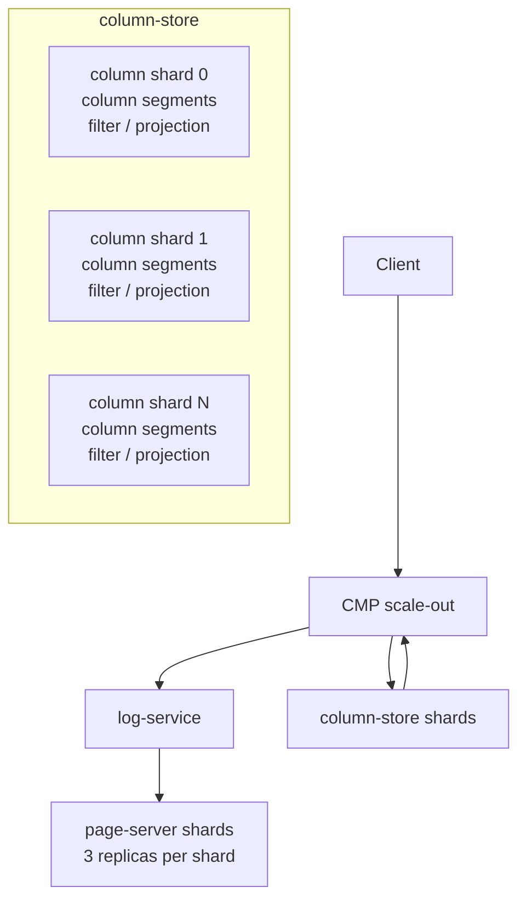
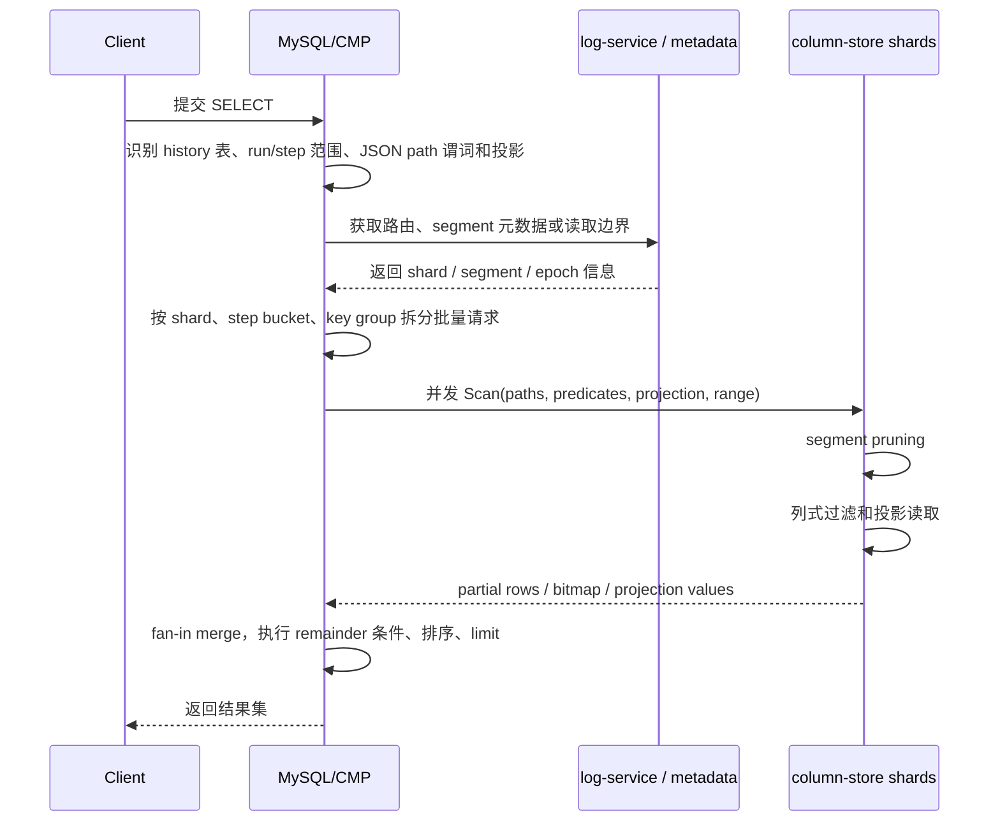
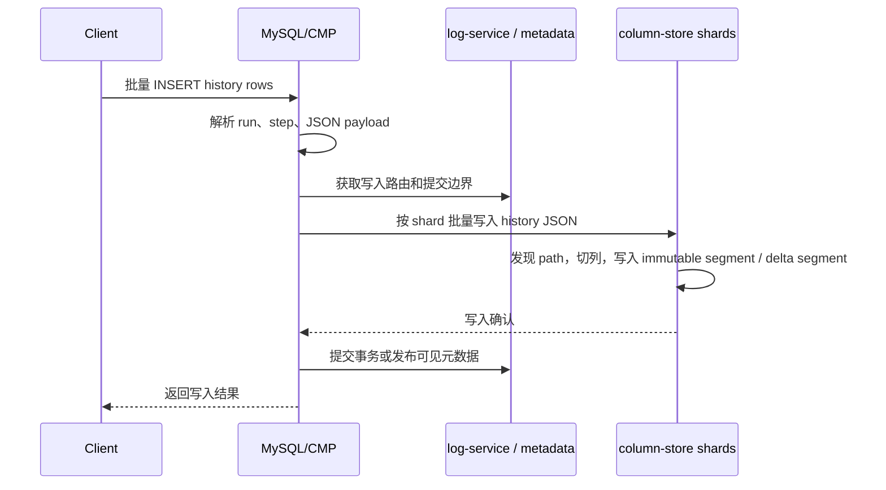

# GaiaDB Column-Store JSON 架构说明

## 1. 背景与目标

GaiaDB 面向 WandB/history 类宽 JSON 场景时，单行 JSON 可能包含大量动态 metric key，但多数查询只访问少量 path。继续按完整 JSON 对象读取，会带来不必要的数据搬运和解析成本。

新的目标架构把 history JSON 从传统 PageServer 热路径中拆出来，由 CMP 直接写入和查询 column-store。column-store 将 JSON path 切成列式 segment，并在 shard 内完成过滤和投影，CMP 负责 SQL 接入、路由、fan-out/fan-in、remainder 条件和结果返回。

关键边界：

- PageServer 仍负责普通 InnoDB page 和
- 据。
- history JSON 的热读写路径由 CMP 直接访问 column-store。
- PageServer 与 column-store 是两条独立数据路径。
- 列式过滤和投影计算在 column-store shard 内完成。

## 2. 整体架构



横向扩展维度：

- add CMP：提高 SQL 接入、计划调度、fan-out/fan-in 能力。
- add page shard：扩展普通 page 存储和传统 GaiaDB 数据路径。
- add column shard：扩展 history JSON 的列式存储、扫描和计算能力。

## 3. 数据组织

column-store 面向 `hs_history(run, step, value JSON)` 这类表，把 JSON path 拆成内部 key catalog 和列式 segment。

一个逻辑行可抽象为：

```text
table_id
run_id
step
json_value
commit_ts / trx_id
```

column-store 内部可以按以下维度组织：

```text
run shard   = hash(table_id, run_id) % N
step bucket = step range bucket
key group   = path key_id group
segment     = immutable columnar file / block
```

每个 column shard 是同构的，持有本 shard 的列式 segment，并在本地完成 path presence 判断、值比较和投影值读取。

## 4. 核心原理

### 4.1 计算下推

计算下推的含义是：CMP 不把完整 JSON 对象拉回本地解析，而是把可表达的 JSON path 谓词和投影请求下发给 column-store shard。

典型可下推计算包括：

- `JSON_CONTAINS_PATH(value, 'all'/'one', path...)`
- `JSON_EXTRACT(value, path)` 的常量比较
- SELECT 投影中的少量 JSON path

在 column-store 中，JSON path 已经被切成列式结构：

- path dictionary 将 JSON path 映射为内部 `key_id` / `key_group`。
- presence bitmap 表达某行是否存在该 path。
- type tag 和 value column 保存该 path 的类型和值。
- segment footer 保存 run/step 范围、key set、统计信息和校验信息。

因此：

- `JSON_CONTAINS_PATH` 可以转化为 presence bitmap 检查。
- `JSON_EXTRACT` 比较可以转化为读取对应 value column 后做向量化比较。
- 投影可以只读取查询需要的 path value，而不是读取完整 JSON。

CMP 仍保留 SQL 语义边界：

- SQL 解析、权限、优化器和结果集协议仍在 CMP。
- 普通列条件、join、排序、聚合、limit 和无法下推的表达式仍由 CMP 执行或协调。
- unsupported path、复杂 JSON 表达式、类型不确定场景需要走 fallback 或保留在 CMP 层处理。
- 事务可见性和提交边界由 CMP 与元数据/日志系统协调，column-store 不自行替代 SQL 事务语义。

### 4.2 批量与并发 fan-out

CMP 不按单行向 column-store 发请求，而是按扫描范围和 path 集合做批量请求。

一次查询会先形成逻辑请求：

```text
table_id
run_id / run range
step_begin, step_end
predicate paths
projection paths
order / limit hints
read timestamp or commit boundary
```

CMP 根据元数据把请求拆分为多个子请求：

- 按 run shard 路由到不同 column shard。
- 按 step bucket 做 segment pruning。
- 按 key group 只访问相关 path group。
- 对多个 shard 并发发送请求，并在 CMP 侧做 fan-in。

column-store shard 内部继续做本地并行：

- 多 segment 并发扫描。
- 只读取被查询 path 对应的列。
- 用 bitmap 和向量化执行完成过滤。
- 只返回匹配行的必要投影值、row id 或排序键。

这套 fan-out/fan-in 的核心价值不是简单增加线程，而是把大范围 history 查询拆成多个可并行、可裁剪、可批处理的列式扫描单元。它避免每行一次 RPC，也避免每行读取完整 JSON。

## 5. 执行流程

### 5.1 查询流程



### 5.2 写入流程



说明：

- 写入链路以批量为基本单位，不建议每行同步等待一次完整远端提交。
- column-store shard 内部负责本 shard 的 path discovery、segment 写入和本地索引。
- 事务可见性、失败重试和幂等写入需要通过 CMP 与元数据/日志系统约束。

## 6. 性能收益来源

### 6.1 列存方案与行存方案对比

| 对比项 | 行存方案 | 列存方案 |
| --- | --- | --- |
| 存储粒度 | 每行保存完整 JSON 对象或完整 binary JSON。 | JSON 按 path/key group 切成列式 segment，必要时保留原始 JSON fallback。 |
| 查询读取单位 | 查询少量 path 时，仍可能读取整行完整 JSON。 | 只读取相关 path 所在列、bitmap 和必要 segment。 |
| JSON 解析成本 | 读时解析完整 JSON，path 越少越浪费。 | 写入或整理阶段完成 path 切分，读时直接访问列式结构。 |
| `contains_path` | 需要进入 JSON 对象查找 path。 | 可转化为 presence bitmap 检查。 |
| `JSON_EXTRACT` 投影 | 需要从完整 JSON 中查找并提取目标 path。 | 直接读取对应 value column，只返回需要的投影值。 |
| 范围扫描 | 大范围扫描会放大完整 JSON 读取、解析和网络返回量。 | 按 shard、step bucket、key group 做 pruning 和 fan-out。 |
| 并发扩展 | 主要扩展对象读取和整行解析能力。 | 扩展 column shard、segment scan 和 CMP fan-in 能力。 |
| 写入路径 | 写入简单，通常按行追加完整 JSON。 | 写入更复杂，需要 path discovery、切列、segment manifest 和 schema/key 演进。 |
| 存储元数据 | 元数据较少，主要定位对象或行。 | 需要 key catalog、segment manifest、path dictionary、replica/placement 信息。 |
| 适合场景 | 点查完整 JSON、需要频繁返回整对象、path 不稳定且查询很分散。 | 宽 JSON、少量热点 path、范围扫描、过滤/投影明显小于完整对象。 |
| 主要风险 | 读放大、解析放大、CMP/网络容易成为瓶颈。 | 写入复杂度、元数据一致性、compaction/repair、fallback 语义。 |

列存方案不是全面替代行存方案。更合理的边界是：热 path、范围扫描和高并发分析查询优先走列存；完整 JSON 返回、复杂表达式或未覆盖 path 可以保留行存 fallback。

### 6.2 收益来源

性能收益主要来自以下几个方向。

第一，减少数据搬运。查询少量 JSON path 时，column-store 只读取和返回相关 path 的列值，不再把完整 JSON 对象从存储侧搬回 CMP。

第二，减少读时 JSON 解析。热点 path 在写入或后台整理时已经切成列式 segment，读时可以直接查 presence bitmap、type tag 和 value column，避免每次查询重新解析完整 JSON。

第三，提高过滤效率。`contains_path` 类条件可以变成 bitmap 检查，`extract` 比较可以变成列式向量化过滤。未命中的行不需要返回完整 JSON 或无关投影值。

第四，批量摊薄 RPC 成本。CMP 将一个范围扫描拆成 shard/segment 级批量请求，避免单行 RPC 的高固定开销。

第五，提升并行度。多 CMP、多 column shard、多 segment 可以同时工作；大范围 history 查询可以按 run shard、step bucket、key group 并行 fan-out，再由 CMP fan-in merge。

第六，提升缓存和 I/O 局部性。列式 segment 比完整 JSON 更适合按 path 访问，热点 path group 可以更容易留在内存或本地 SSD cache 中。

第七，隔离扩展普通 page 路径和 history JSON 路径。PageServer 继续服务普通 page，column-store 独立扩展宽 JSON 的存储和扫描能力，避免把两类负载绑定到同一个瓶颈上。

需要注意：这些是收益来源，不是未经验证的性能结论。实际收益取决于 JSON 大小、path 数量、过滤选择率、segment pruning 命中率、缓存命中率、并发度、网络和磁盘资源。

## 7. 当前边界

- column-store 适合 append-oriented history JSON 和少量 path 查询，不适合任意复杂 JSON 表达式一开始全部下推。
- 复杂 SQL 语义仍由 CMP 负责，column-store 只做可表达、可验证的列式过滤和投影。
- PageServer 与 column-store 是两条数据路径：没有 PageServer 到 column-store 的写入链路。
- 对外不要描述为“所有 JSON 查询都会加速”，应描述为“宽 JSON、少量 path、范围扫描、批量并发场景具备明显收益来源”。