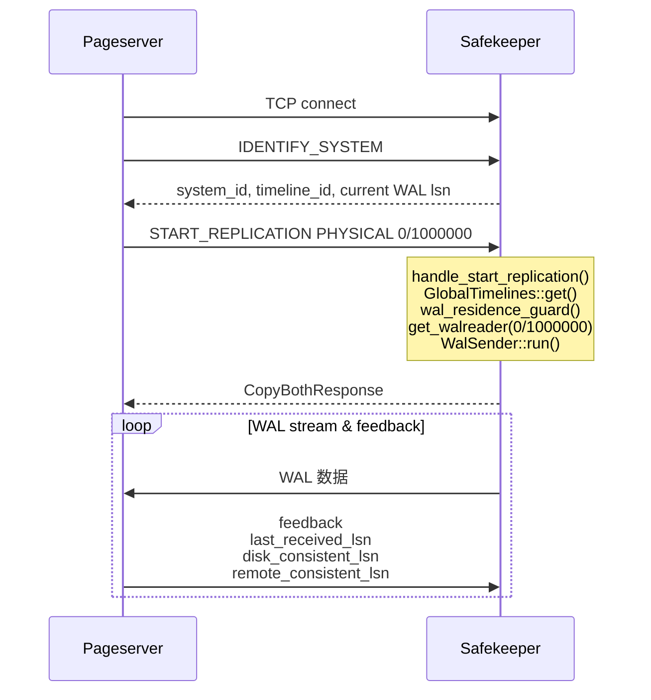

## 数据流:

```
PostgreSQL / Compute
        │
        │ WAL(Multi-raft选主)
        ▼
   walproposer
        │
        │ START_WAL_PUSH
        ▼
   safekeeper
        │
        ├── 写入本地 WAL 文件
        ├── 多副本之间做 term / election / recovery
        └── 根据 commit_lsn 判断哪些 WAL 已提交
                │
                │ START_REPLICATION
                ▼
             pageserver
```


### CMP

1. cmp通过`XLogFlush()`把wal写入并fsync到cmp本地的pg_wal（）。结束时会调用`WalAndWakeup()`,唤醒walproposer来进行发送wal。

2. walproposer 是一个独立的 bgworker 进程。等待同一个CV（`WalSndCtl->wal_flush_cv`）被唤醒后

   i. 读取 `GetFlushRecPtr()`；

   ii.从本地 `pg_wal` 读出新 WAL；

   iii.异步发送给各 safekeeper。

3. `SyncRepWaitForLSN` 会阻塞，原因是 neon 默认配置了 `synchronous_standby_names = 'walproposer' `，会将其认为同步备库。收到信号后才会调用 `TransactionIdCommitTree()`,写clog，标记为提交。


**为什么这么设计，为什么不采用flush的时候直接send了**

1. `XLogFlush `在临界区里，网络错误会让整个实例 PANIC。比如连接断开，超时等。
2. `XLogFlush` 写盘时持有 `WALWriteLock`， 锁内加网络 RTT 会让所有提交串行。
3. 直接复用 PG 已有的同步复制机制，PG 补丁很小。walproposer 伪装成一个名叫 `walproposer` 的物理 walsender，直接复用复制槽那套逻辑。
4. **代价**：多一次跨进程唤醒（CV 广播、设置 latch、进程调度），在微秒级，相比网络 RTT 加远端 fsync 的毫秒级可以忽略。异步解耦还带来流水线效果：后端在等上一批 WAL 确认时可以继续生成新的 WAL。


### 时序图


### wal发送给safekeeper的流程

```c++
WalAcceptor::run()
|--> WalResidentTimeline::process_msg()
|	|-->Safekeeper::process_msg()  //统一处理 walproposer 发来的消息
|	|	|-->case: handle_greeting() //处理初始握手
|	|	|-->case: handle_vote_request()//处理选举投票
|	|	|-->case: handle_elected()//新 proposer 当选后的处理
|	|	|-->case: handle_append_request() //wal写入处理
|	|	|	|-->PhysicalStorage::write_wal()
|	|	|	|-->update_commit_lsn()//更新commit_lsn位置
|	|	|	|-->flush_lsn() //刷新flush_lsn
|	|	|-->handle_flush() //强制刷盘
```


### Pageserver拉取请求：

一旦建立连接后，后续会loop循环不断的拉去wal

```c
Pageserver
|	|
|   | START_REPLICATION PHYSICAL <start_pos>
|	|-->//把 Safekeeper 的 WAL 服务伪装成一个 PostgreSQL replication server，负责处理连接、认证、Copy
|	|-->SafekeeperPostgresHandler::handle_start_replication()
|	|	|-->GlobalTimelines::get()
|	|	|-->Timeline::wal_residence_guard()
|	|	|-->handle_start_replication_guts()
|	|	|	|-->WalSenders::register()
|	|	|	|-->get_walreader(start_pos)
|	|	|	|	|-->WalSender::run() //把已经落盘的wal读出去推给pageserver
|	|	|	|	|	|-->wait_wal() //等待新的wal
|	|	|	|	|	|-->wal_reader.read()//读wal 到buffer
|	|	|	|	|	|-->BeMessage::XLogData()//WAL 封装成 PostgreSQL replication 协议的 XLogData 消息
|	|	|	|	|	|-->PostgresBackend::write_message() //发送出去
```

`wal_residence_guard()` 保证：

- 当前 Timeline 的 WAL 在本地可读
- Timeline 不会在读取期间被 eviction
- 读 WAL 的任务和删除、迁移 WAL 的任务不会冲突
- 如果 Timeline 已被 offload，先触发恢复


### timeline

这里的 `timeline` 可以理解成 Neon 中一条数据库历史分支，也是一条独立的 WAL 日志空间。

Neon 支持：

- 数据库分支
- 时间点分支
- 从已有数据库创建新分支
- 多个独立的数据库历史
- 按租户隔离存储

因此需要把每条 WAL、每个 Pageserver layer、每个 Safekeeper 数据目录归属到某条独立历史上：

```c++
safekeeper data directory/
└── tenant_id/
    └── timeline_id/
        ├── safekeeper.control
        └── WAL segment files
```

每条 Timeline 有自己的：

- WAL 序列
- LSN 空间
- PostgreSQL system ID
- term history
- Safekeeper 副本
- Pageserver 数据层
- `commit_lsn`
- `flush_lsn`
- `remote_consistent_lsn`

因此 Timeline 是 WAL 和页面数据的隔离边界。
